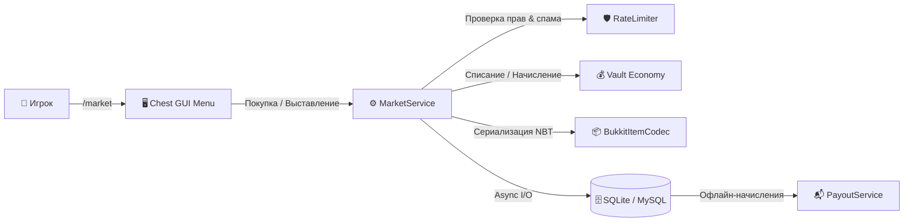

<div align="center">

# 🛒 ɴᴀɴᴏᴍᴀʀᴋᴇᴛ

**Высокопроизводительный серверный рынок предметов нового поколения для Paper / Spigot 1.20+**

[](https://github.com/nanodevmc/NanoMarket/releases)
[](https://papermc.io)
[](https://openjdk.org)
[](LICENSE)
[](https://t.me/WineSquad)

<p align="center">
  <i>Полноценная замена устаревшим плагинам аукциона: асинхронная БД, валидация через PDC, отсутствие дюпов, офлайн-выплаты и стильный GUI с поддержкой Small Caps.</i>
</p>

---

</div>

## ❖ ᴋᴧючᴇʙыᴇ ʙозʍожноᴄᴛи

<table>
<tr>
<td width="50%" valign="top">

### ⚡ ᴀᴄинхᴩонный дʙижоᴋ
- **Zero-lag архитектура**: все операции чтения и записи лотов выполняются в пуле потоков.
- Поддержка локальной **SQLite** (без дополнительных настроек) и удалённой **MySQL** для межсерверной синхронизации.
- Автоматическая оптимизация запросов и транзакционность.

</td>
<td width="50%" valign="top">

### 🛡 ᴀнᴛи-дюᴨ & ʙᴀᴧидᴀция PDC
- Полная сериализация ItemStack через нативный **Bukkit PersistentDataContainer** и NBT.
- Защита от дублирования при одновременной покупке одного лота несколькими игроками.
- Встроенный RateLimiter для блокировки спама кликами в меню.

</td>
</tr>
<tr>
<td width="50%" valign="top">

### 💰 гибᴋᴀя эᴋоноʍиᴋᴀ & ʙыᴨᴧᴀᴛы
- Нативная интеграция с **Vault Economy** ($) и кастомными валютами.
- Поддержка налога на выставление и комиссионного сбора при продаже.
- Сервис **PayoutService**: безопасная доставка валюты продавцу, даже если он находится офлайн.

</td>
<td width="50%" valign="top">

### 🎨 инᴛᴇᴧᴧᴇᴋᴛуᴀᴧьный ɢᴜɪ
- Пагинация, динамическое обновление страниц без мерцания.
- Сортировка лотов: по цене (возрастание/убывание), по дате и новизне.
- Интерактивный поиск предметов через чат или команду `/market search`.
- Оформление малым шрифтом (Small Caps) и адаптивными символами.

</td>
</tr>
</table>

---

## 🏛 ᴀᴩхиᴛᴇᴋᴛуᴩᴀ ᴩᴀбоᴛы



---

## 📋 ᴋоʍᴀнды и ᴨᴩᴀʙᴀ

| Команда | Описание | Право (Permission) |
|---|---|---|
| `/market` | Открыть главное меню рынка | `nanomarket.use` *(по умолчанию всем)* |
| `/market sell <цена>` | Выставить предмет из руки на продажу | `nanomarket.sell` *(по умолчанию всем)* |
| `/market my` | Просмотр своих активных лотов и снятие с продажи | `nanomarket.use` |
| `/market search <запрос>` | Быстрый поиск предметов по названию или типу | `nanomarket.use` |
| `/market history` | История недавних продаж и покупок | `nanomarket.use` |
| `/market admin` | Панель администратора (модерация и очистка) | `nanomarket.admin` *(OP)* |
| `/market reload` | Перезагрузка конфигураций и сообщений | `nanomarket.admin` *(OP)* |

### Специальные права:
- `nanomarket.bypass.limit` — снятие ограничения на максимальное количество одновременных лотов.
- `nanomarket.bypass.blacklist` — разрешение продавать предметы из чёрного списка.

---

## ⚙ ᴋонɸиᴦуᴩᴀция (`config.yml`)

```yaml
# ═══════════════════════════════════════════════════════════════
#             ɴᴀɴᴏᴍᴀʀᴋᴇᴛ  │  ᴋᴏнɸиᴦуᴩᴀция
# ═══════════════════════════════════════════════════════════════

database:
  type: SQLITE          # SQLITE или MYSQL
  mysql:
    host: localhost
    port: 3306
    database: nanomarket
    username: root
    password: ""
    pool-size: 10

market:
  default-lot-limit: 10 # Лимит лотов на игрока
  lot-expire-hours: 72  # Время жизни лота до возврата
  tax:
    listing-fee: 0.0    # Фиксированная плата за выставление ($)
    percent: 5.0        # Процент комиссии при успешной продаже (%)

style:
  small-caps: true      # Использовать малый шрифт в заголовках
  prefix: "&#00DC82● &#E6EDF7ɴᴀɴᴏʍᴀʀᴋᴇᴛ &#3A4256│ "
```

---

## 🛠 ᴄбоᴩᴋᴀ из иᴄходниᴋоʙ

Требования: **Java 17+** и **Maven 3.8+**.

```bash
# Клонирование репозитория
git clone https://github.com/nanodevmc/NanoMarket.git
cd NanoMarket

# Сборка JAR-файла
mvn clean package -DskipTests
```

Собранный плагин появится в папке `target/NanoMarket-2.0.0.jar`.

---

## 👤 ᴀʙᴛоᴩ & ᴋонᴛᴀᴋᴛы

- **Разработчик**: **NanoDev**
- **Официальный Telegram канал**: [t.me/WineSquad](https://t.me/WineSquad)
- **Личная связь**: [@radoqi](https://t.me/radoqi)
- **GitHub**: [github.com/nanodevmc](https://github.com/nanodevmc)
- **Лицензия**: [MIT License](LICENSE)
